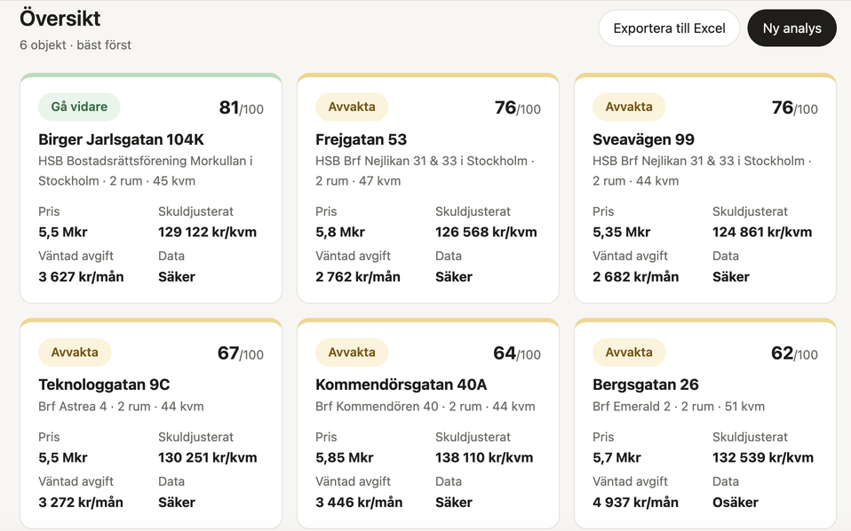
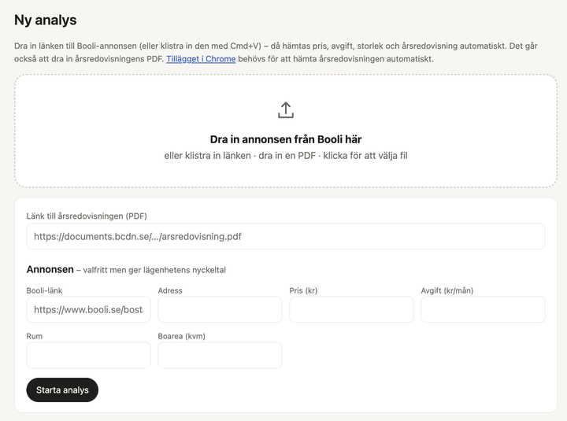
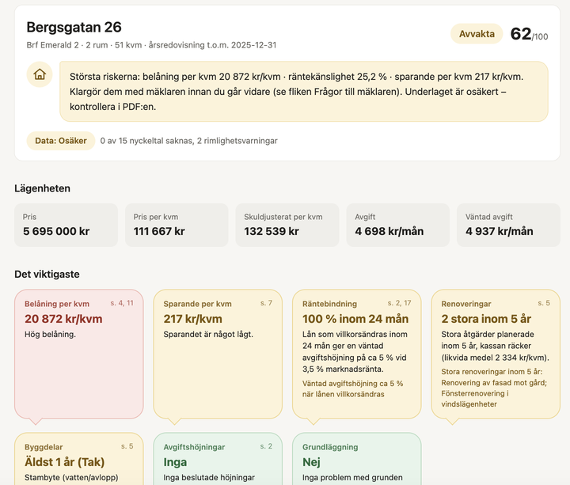
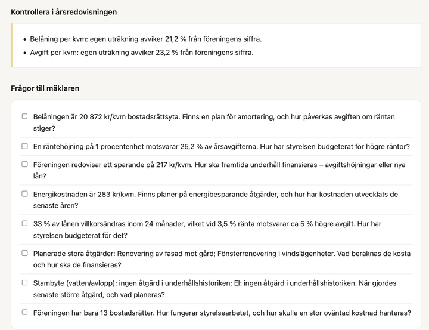

# Bostadsanalys

Sållar bostadsrätter till salu på Booli genom att läsa föreningens årsredovisning och ge ett
tydligt utslag – **Gå vidare**, **Avvakta** eller **Sortera bort** – med poäng, en motivering i
klartext, de viktigaste nyckeltalen och färdiga frågor till mäklaren.

Dra in en Booli-annons, så hämtas pris, avgift, storlek och årsredovisning automatiskt.



## Grundprincip

**Claude extraherar – Python räknar och bedömer.** Claude läser bara av värden ur
årsredovisningen (med sidnummer, `null` om något saknas, aldrig gissat). Alla nyckeltal, färger
och utslag räknas i Python mot gränserna i [`kriterier.py`](kriterier.py) – så bedömningen är
spårbar och går att justera utan att röra koden.

## Så fungerar det

### 1. Ny analys – dra in annonsen



Dra länken till Booli-annonsen till boxen (eller klistra in den med Cmd+V). Chrome-tillägget
hämtar annonsen och föreningssidan i din inloggade Chrome; appen fyller i adress, pris, avgift,
rum och boarea och hittar årsredovisningen. Har årsredovisningen inte lästs förut frågar appen
först – analysen kostar ca 1–2 kr (Claude-API:t). Samma PDF läses aldrig två gånger.

Det går också att dra in årsredovisningens PDF direkt.

### 2. Resultatet



- **Utslag och poäng (0–100).** Stoppfaktorer (oäkta förening, revisorns anmärkning,
  grundproblem, väntad avgiftshöjning ≥ 20 %) ger alltid *Sortera bort*. Två röda tunga
  kriterier ger *Sortera bort*, ett ger högst *Avvakta*. Annars avgör den viktade poängen.
- **Motiveringen** – de största riskerna i en mening.
- **Datakvalitet** – *Säker* eller *Osäker* beroende på saknade nyckeltal och rimlighetsvarningar.
- **Lägenheten** – pris, pris per kvm, **skuldjusterat pris** (pris + din andel av föreningens
  skuld), avgift och **väntad avgift** (efter beslutade höjningar eller när lånen villkorsändras
  till marknadsräntan).
- **Nyckeltalen som bubblor** – röd, gul eller grön, med sidnummer i årsredovisningen.
  *Det viktigaste* (belåning, sparande, räntebindning, avgiftshöjningar, renoveringar,
  byggdelar, grundläggning) står först.

### 3. Kontrollera och fråga mäklaren



Rimlighetskontroller fångar troliga felavläsningar (ytor som inte går ihop, lånenot som inte
stämmer med balansräkningen, egna nyckeltal som avviker från föreningens). Frågorna till
mäklaren är en checklista att bocka av på visningen.

## Vad som bedöms

Belåning per kvm (bostadsrättsyta) · räntekänslighet · sparande · avgift per kvm (på dagens
avgiftsnivå) · avgiftshöjningar · räntebindning med väntad avgiftshöjning vid marknadsränta ·
planerade renoveringar mot kassan · byggdelars ålder (stambyte, tak, fasad, el) · grundläggning ·
äkta/oäkta förening · energikostnad · föreningens storlek · tomträtt · revisorns berättelse ·
årsredovisningens ålder.

## Kom igång

```bash
cd ~/Projects/bostadsanalys
python3 -m venv venv
venv/bin/pip install -r requirements.txt
cp .env.example .env          # lägg in din ANTHROPIC_API_KEY
venv/bin/python -m uvicorn app.server:app --port 8000 --reload
```

Öppna http://localhost:8000.

**Chrome-tillägget** (en gång): öppna `chrome://extensions` → slå på *Utvecklarläge* →
*Läs in okomprimerat* → välj mappen [`tillagg/`](tillagg). Booli visar årsredovisningen bara
för inloggade, och tillägget låter appen läsa den i din Chrome. Det får bara läsa booli.se och
bara svara appen på din dator. Sidan `#/tillagg` i appen visar om det fungerar.

## Projektet

| Del | Gör |
|---|---|
| [`app/`](app) | Webbappen: FastAPI-server ([`server.py`](app/server.py)) och gränssnitt ([`static/`](app/static)) |
| [`tillagg/`](tillagg) | Chrome-tillägget som hämtar Booli-sidor åt appen |
| [`booli.py`](booli.py) | Läser Booli-annonsen och föreningssidan |
| [`extract_report.py`](extract_report.py) | Årsredovisning (PDF) → JSON med Claude |
| [`bedomning.py`](bedomning.py) | Nyckeltal, färger och frågor till mäklaren |
| [`utslag.py`](utslag.py) | Stoppfaktorer, poäng, motivering, datakvalitet |
| [`rimlighet.py`](rimlighet.py) | Rimlighetskontroller av extraktionen |
| [`lagenhet.py`](lagenhet.py) | Skuldjusterat pris och väntad avgift |
| [`kriterier.py`](kriterier.py) | Alla gränsvärden, vikter och marknadsräntan |
| [`export_excel.py`](export_excel.py) | Valfri export till Excel (knapp i appen) |
| [`analysera.py`](analysera.py) | Hela kedjan i terminalen (`--excel` för Excel) |
| [`bokmarke/`](bokmarke) | Bokmärke för Booli – alternativ till tillägget |

Data (PDF:er, extraktioner, bedömningar) ligger i `data/` och checkas inte in.

## Tester

Inga tester anropar Claude-API:t.

```bash
for t in tests/test_*.py; do venv/bin/python $t; done
node bokmarke/test_bokmarke.js
```

## Begränsningar

Verktyget sållar utifrån årsredovisningen – det är ingen värdering av lägenheten och ersätter
inte visningen, frågor till mäklaren eller egen granskning. Byggdelarnas ålder tolkas från
fritext och kan bli fel (t.ex. relining av en huvudledning räknas som stambyte) – kontrollera
alltid underhållshistoriken i årsredovisningen.
